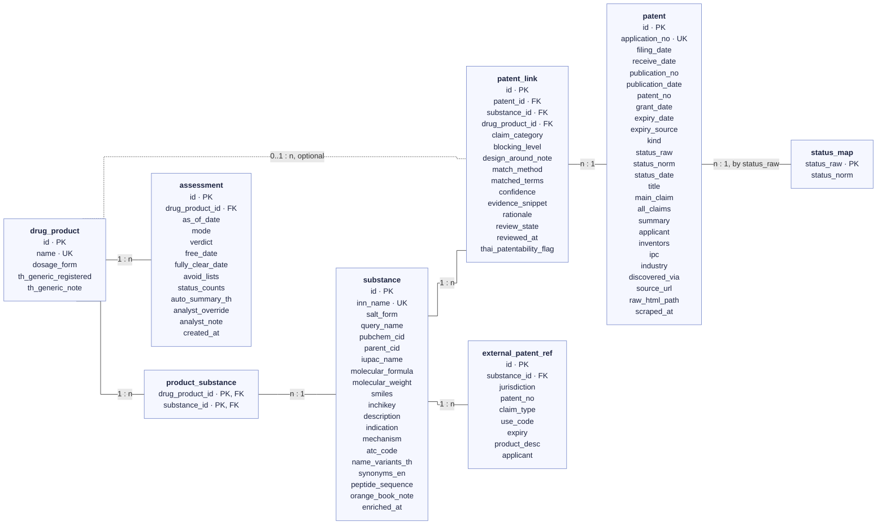
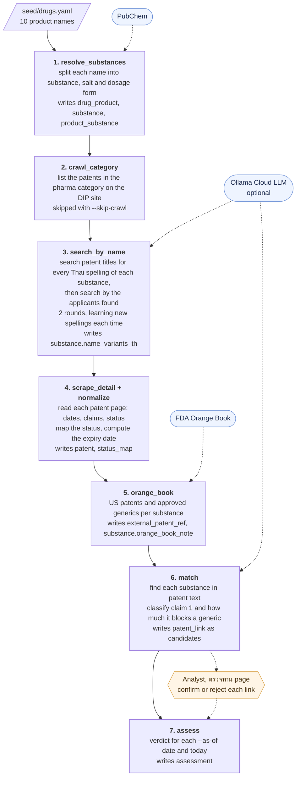

# Thai Drug–Patent Landscape

A local web app that maps Thai patents onto target generic drugs. For each drug it shows which Thai patents and
applications relate to it, what kind of claim each one makes, and whether each one is still in force. From that
it judges whether a Thai manufacturer can make the generic now, only by avoiding certain patents, or only after a
given date.

The database is loaded from the two Thai FDA drug-patent reports in `data/pdf/`
(`รายงานข้อมูลสิทธิบัตรของรายการยาที่อยู่ในบัญชียามุ่งเป้าที่มีลำดับความสำคัญสูง`): 40 products as of 2017–2019 and
10 products as of 20 Jul 2022, with the 277 Thai patents and applications their tables list. The loader stores
the drugs and the patents but **not** which product each patent was listed under, so the matcher has to link
them itself: it finds each substance in the patent text, classifies the claim and computes a verdict. The
reports' own grouping, claim types and conclusions are the ground truth the links are scored against (see
[Evaluation](#evaluation-against-the-รายงาน-อย)).

The original pipeline, which discovers patents on the Thai Department of Intellectual Property (DIP) site
starting from nothing but product names, is still in `etl/` with its raw page cache in `data/raw/`. Its data
is no longer in the database.

The app has five pages:

- **ยา (Drugs)**: each product with its PubChem profile (structure image, IUPAC name, formula, ATC code,
  indication, mechanism), the Thai spellings found in patent text, its US Orange Book context, and its verdict
  with a generated Thai summary and a patent timeline.
- **สิทธิบัตร (Patents)**: the fields the รายงาน อย. uses (application no./date, publication no./date, patent
  no./grant date, expiry, type/status, title, main claim, summary), searchable and filterable.
- **การจับคู่ (Matching)**: a network graph of drugs, substances and patents, coloured by claim category and
  blocking level.
- **ตรวจทาน (Review)**: a queue where an analyst confirms or rejects each automatic link and corrects its claim
  category or blocking level.
- **ประเมินผล (Evaluation)**: the pipeline's score against the รายงาน อย., per metric and per product, with
  every disagreement listed.

## Data sources

All data comes from public sources.

| source | used for | module |
|---|---|---|
| รายงาน อย. (Thai FDA with DIP), `data/pdf/20210401083633.pdf` (40 products) and `202304201661685407.pdf` (10 products) | the drugs (name, dosage form, IUPAC name, formula, other names, indication) and the patents (numbers, dates, expiry, status, title, main claim, summary) | `pdf_report`, `load_pdf` |
| [PubChem PUG REST / PUG View](https://pubchem.ncbi.nlm.nih.gov/docs/pug-rest) (NIH), optional | synonyms and any field the report leaves empty (`--pubchem`) | `pubchem`, `resolve_substances` |
| [Ollama Cloud](https://docs.ollama.com/cloud) (optional) | Thai transliteration suggestions and claim classification by an LLM | `llm` |
| DIP site and [FDA Orange Book data files](https://www.fda.gov/drugs/drug-approvals-and-databases/orange-book-data-files) | the scraping pipeline only (not in the current database) | `crawl_category`, `search_by_name`, `scrape_detail`, `orange_book` |

From the reports the matcher never sees which product a patent was listed under, the report's claim type or its
conclusions: those are held out in `eval/golden/` and read only by the evaluation.

## Quick start

```bash
python -m venv .venv && .venv/Scripts/pip install -r requirements.txt     # Windows; use .venv/bin on macOS/Linux
.venv/Scripts/python -m pytest -q                                           # tests

# 1. Build the data from the reports in data/pdf/ (~30 s; backs up data/app.db, then replaces its drugs/patents)
.venv/Scripts/python -m etl.load_pdf --match --no-llm
#    with the LLM (needs OLLAMA_API_KEY in .env): drop --no-llm;  add PubChem synonyms: --pubchem
#    the scraping pipeline instead (~1 h first run): .venv/Scripts/python -m etl.pipeline --as-of 2022-07-20

# 2. Run the app
.venv/Scripts/uvicorn backend.app:app --port 8000
cd frontend && npm install && npm run dev        # http://localhost:5173  (proxies /api to :8000)
#    or a single server:  npm run build  → then just open http://localhost:8000
#    if port 8000 is taken: uvicorn ... --port 8077  and  API_PORT=8077 npm run dev
```

## Data model

The database is SQLite (`data/app.db`). [backend/models.py](backend/models.py) is the reference: every column
there has a description (what it means, where it comes from, its format, what null means), and a test fails if
one is missing.

| table | one row is | written by (`load_pdf`; scraping pipeline step) |
|---|---|---|
| `drug_product` | a product in a report | `load_pdf` (step 1); the analyst fills in `th_generic_*` |
| `substance` | an active ingredient: facts from the report heading (or PubChem), Thai spellings, Orange Book note | `load_pdf`, `name_variants` (steps 1, 3 and 5) |
| `product_substance` | "this product contains this substance" | `load_pdf` (step 1) |
| `patent` | a Thai patent or patent application | `load_pdf` (steps 2–4) |
| `status_map` | a status text seen and the status it maps to | `normalize` (step 4) |
| `patent_link` | "this patent claims something about this substance", with the claim category and how much it blocks a generic | `match` (step 6); then the analyst confirms or rejects it |
| `external_patent_ref` | a US Orange Book patent for the substance | step 5 only (empty after `load_pdf`) |
| `assessment` | the verdict for one product on one as-of date | `assess` (step 7); an analyst override adds a new row |



How to read it: each box is a table with all its columns. `PK` marks the primary key, `FK` a foreign key and
`UK` a unique column. Lines join tables on their keys, and the label gives the cardinality: `1 : n` means one row
in the table on the left of the label matches many in the table on its right. The dotted line is optional: a link
can name one product.

- A patent links to a **substance**, not a product, so a substance, salt or crystal-form patent applies to every
  product containing that substance. An analyst can narrow a link to one **drug product** (`drug_product_id`)
  when the claim only covers one dosage form, such as a device or a formulation.
- `patent.status_norm` is the status on `patent.status_date`: the report date for a patent loaded from a
  report, today for a DIP page (`status_date` null). The status on another date is computed when needed and never
  stored; a final status (abandoned, revoked, expired) is trusted from its `status_date` on.
- The verdict is recomputed live for any as-of date. `assessment` keeps the results of pipeline runs and the
  analyst overrides, which are added as new rows rather than replacing old ones.
- Dates are stored in the Common Era (ISO). Screens and exports add a Buddhist Era (พ.ศ.) copy, in columns
  ending `_be`.

**Value lists.** These columns only take the values below. Each list is a `StrEnum` in `backend/models.py`.
The values are stored as plain text, and an enum member equals its text (`ReviewState.CONFIRMED == "confirmed"`).

| column | values | enum |
|---|---|---|
| `patent.kind` | `invention`, `petty`, `design`, `unknown` | `PatentKind` |
| `patent.expiry_source` | `computed_invention_20y`, `computed_petty_10y`, `computed_design_10y`, `stated` | `ExpirySource` |
| `patent.status_norm`, `status_map.status_norm` | `granted_active`, `pending_unexamined`, `pending_examining`, `expired`, `abandoned`, `revoked` | `PatentStatus` |
| status on a past date (computed) | the six above, plus `not_published` and `likely_abandoned` | `PatentStatus` |
| `patent_link.claim_category` | `drug_substance`, `solid_form`, `process`, `formulation`, `device`, `use`, `combination` | `ClaimCategory` |
| `patent_link.blocking_level` | `blocking` (no generic until it ends), `avoidable` (design around it), `not_relevant` (mentioned, not claimed) | `BlockingLevel` |
| `patent_link.match_method` | `keyword` (rules), `llm`, `manual` (an analyst edited it) | `MatchMethod` |
| `patent_link.review_state` | `candidate`, `confirmed`, `rejected` | `ReviewState` |
| `assessment.mode` | `auto` (every link not rejected), `confirmed` (confirmed links only) | `AssessmentMode` |
| `assessment.verdict`, `analyst_override` | `free`, `free_with_avoidance`, `blocked_until`, `pending_review`, `unknown` | `Verdict` |
| `external_patent_ref.claim_type` | `drug_substance`, `drug_product`, `use`, `other` | `OrangeBookClaimType` |

**JSON columns.** In Python these are plain lists and dicts. They are stored as UTF-8 JSON text, so Thai stays
readable. To change one, assign a new list or dict; editing it in place is not saved.

| column | shape |
|---|---|
| `substance.synonyms_en` | `["Leuprorelin", "leuprolide", …]` |
| `substance.name_variants_th` | `{"observed": [{"spelling", "docs", "source"}, …], "probes": [spellings still to try]}` |
| `patent.discovered_via` | `["pdf:<report file>"]`, or `["category:pharma", "title:<spelling>", "applicant:<name>"]` from the scraping pipeline |
| `patent_link.matched_terms` | `{"terms": [names found], "sections": ["title", "claim1", "claims", "summary"]}` |
| `assessment.avoid_lists` | `{"blocking": [rows], "avoid": [rows], "warnings": [rows]}`, one row per patent |
| `assessment.status_counts` | `{"expired": 1, "granted_active": 1}` |

**Upgrading an older database.** `init_db()` runs at app start-up and at the start of every pipeline step. It
adds missing tables and columns, and applies the renames and drops listed in `RENAMED` and `DROPPED` in
[backend/db.py](backend/db.py), after first backing the database up to `app.db.pre-migration-<date>`. A
database built before the October 2026 refactor is upgraded on its first start:
- unused columns are dropped: `drug_product.route`, `strengths`, `on_target_list`, `external_patent_ref.found_in_th`
  and `substance.structure_img_url` (now built from `pubchem_cid`);
- `orange_book_note` moves from `drug_product` to `substance`;
- `assessment.avoid_json` and `counts_json` are renamed `avoid_lists` and `status_counts`.

## Loading the อย. reports

`python -m etl.load_pdf --match` builds the current database
([etl/pdf_report.py](etl/pdf_report.py), [etl/load_pdf.py](etl/load_pdf.py)):

1. **Parse** each PDF. The contents page gives the products and their page ranges. Each patent table is read
   geometrically: its vertical rules are the column borders, every character goes to the column its centre falls
   in, and a row starts where the first column holds a row number, so rows that run over a page break are joined.
   The font drops the nikhahit of sara am ("ส าหรับ"), which is restored.
2. **Back up** `data/app.db` to `app.db.pre-pdf-<date-time>` (a new file every run) and empty the drug, patent, link and assessment tables.
3. **Load** the 50 products (substances split from the name: `Dutasteride + Tamsulosin Capsule …` gives two)
   with the facts under each heading, and the 277 distinct applications as one pool, in application-number
   order. An application listed under several products is stored once, with the most recent report's status.
   Dates that are impossible for the report (before 1979 or after the report date) are dropped as typos.
4. **Match**: `normalize`, then `name_variants` learns the Thai spellings the loaded text actually uses, then
   `match` and `assess` run unchanged.

The report's claim-type column, its conclusions and the product a row was listed under are not stored.
`--pubchem` adds PubChem synonyms (`leuprolide`, `(S)-omeprazole`, …), which the reports don't print.

## Pipeline

The scraping pipeline is kept for rebuilding from the DIP site. `python -m etl.pipeline` runs seven steps
([etl/pipeline.py](etl/pipeline.py)). The only drug input is `seed/drugs.yaml`, which holds the 10 product names.
Every step reads what earlier steps stored in the database, so each one can also be run on its own
(`python -m etl.<module>`).



| step | module | what it does |
|---|---|---|
| 1 | `resolve_substances` | splits product names into substance + salt + dosage form; PubChem lookup |
| 2 | `crawl_category` | crawls `RegistrationEnding.aspx` for the อุตสาหกรรมยา group (granted pharma patents with ≤5 years left, or expired) |
| 3 | `search_by_name` | searches `PublicDocument.aspx` titles (all published applications, including pending and abandoned) for every Thai spelling, then expands by applicant; repeats as new spellings are learned |
| – | `thai_translit`, `name_variants` | rule-based English→Thai transliteration and phonetic-skeleton matching to find the spellings patents actually use |
| 4 | `scrape_detail`, `normalize` | parses detail pages; maps statuses (`seed/status_map.yaml`); computes expiry (filing + 20 y, petty patents 10 y) and point-in-time status |
| 5 | `orange_book` | FDA Orange Book patents and exclusivities, generic (ANDA) counts |
| 6 | `match` | candidate links (drug name found in title / claim 1 / claims / summary) and claim classification |
| 7 | `assess` | verdict engine |

Site notes: the DIP site doesn't honour the ยาเคมี sub-category filter on plain HTTP postbacks, so the crawl
takes the whole อุตสาหกรรมยา group. `RegistrationEnding.aspx` only lists patents with ≤5 years left, so
longer-lived patents and all pending or abandoned applications are found through the title search.

### Example: one product through the pipeline

This follows **Leuprorelin powder and solvent for prolonged-release suspension for injection** from its seed
line to its verdict as of 20 Jul 2022, in `confirmed` mode. The `id` values are the row ids of the scraping
pipeline's database (backed up in `data/app.db.pre-pdf-*`), so you can see how the rows join. Rows are trimmed to
the fields that matter.

**Step 1. The product and its substance.** The seed line is just the name:

```yaml
- name: Leuprorelin powder and solvent for prolonged-release suspension for injection
```

The dosage form is split off. No salt word is left, so `salt_form` is null. PubChem supplies the rest, including
the amino-acid sequence, which matters later because patents often name peptides only by their sequence.

```json
{
  "drug_product": {"id": 3, "name": "Leuprorelin powder and solvent for prolonged-release suspension for injection",
                   "dosage_form": "powder and solvent for prolonged-release suspension for injection"},
  "product_substance": {"drug_product_id": 3, "substance_id": 3},
  "substance": {"id": 3, "inn_name": "leuprorelin", "salt_form": null, "pubchem_cid": 657181,
                "molecular_formula": "C59H84N16O12", "atc_code": "L02AE02",
                "synonyms_en": ["Leuprorelin", "leuprolide", "Leuprorelina", "…"],
                "peptide_sequence": "pGlu-His-Trp-Ser-Tyr-D-Leu-Leu-Arg-Pro-NHEt"}
}
```

**Step 3. Thai spellings.** Candidate spellings come from transliterating the name and its synonyms, plus the
LLM's suggestions when it is configured. The ones
actually found in patent text are kept with the number of patents that use them. The rest stay as probes for
the next search.

```json
{
  "substance.name_variants_th": {
    "observed": [{"spelling": "ลิวโพรไลด์", "docs": 3, "source": "synonym"},
                 {"spelling": "ลูโพรเรลิน", "docs": 1, "source": "generated"},
                 {"spelling": "ลิวโพรลีด", "docs": 1, "source": "synonym"}],
    "probes": ["ลิวโพรเรลิน", "ลิวโปรเรลิน", "ลูโพรรีลิน", "…"]
  }
}
```

**Steps 2 and 4. A patent.** The category crawl lists application 0701006463. Its detail page gives the dates,
status and claims. The expiry date is computed as filing date + 20 years − 1 day. The status text
"ยื่นคำขอชำระค่าธรรมเนียมรายปี" (annual fee filed) maps to `granted_active` through `seed/status_map.yaml`.

```json
{
  "patent": {"id": 683, "application_no": "0701006463", "kind": "invention",
             "filing_date": "2007-12-17", "publication_date": "2013-02-14",
             "patent_no": "76833", "grant_date": "2020-06-24",
             "expiry_date": "2027-12-16", "expiry_source": "computed_invention_20y",
             "status_raw": "ยื่นคำขอชำระค่าธรรมเนียมรายปี", "status_norm": "granted_active",
             "title": "องค์ประกอบที่มีการปลดปล่อยแบบทยอยและวิธีการสำหรับการผลิตองค์ประกอบ",
             "applicant": "ทาเคดะ ฟาร์มาซูติคอล คัมปะนี ลิมิเต็ด", "ipc": "A61K 38/00 A61K 47/12",
             "industry": "อุตสาหกรรมยา", "discovered_via": ["category:pharma"]}
}
```

**Step 5. US context.** The Orange Book lists 10 US patents for leuprorelin products. One `external_patent_ref`
row is stored for each, and a summary goes on the substance:

```json
{
  "external_patent_ref": {"substance_id": 3, "patent_no": "11717555", "claim_type": "drug_product",
                          "expiry": "2039-01-01", "product_desc": "CAMCEVI KIT (EMULSION;SUBCUTANEOUS)"},
  "substance.orange_book_note": "ยาต้นแบบ CAMCEVI ETM, CAMCEVI KIT, ELIGARD KIT; สิทธิบัตรที่ขึ้นทะเบียน 10 ฉบับ (ตัวยา 2, ผลิตภัณฑ์ 6, การใช้ 2), สิ้นอายุล่าสุด 2041-12-22; ยาชื่อสามัญ (ANDA) ได้รับอนุมัติ 10 รายการ"
}
```

**Step 6. The link.** Claim 1 of the patent covers sustained-release microcapsules of an LH-RH derivative
written as a pattern, `5-Oxo-Pro-His-Trp-Ser-Tyr-Y-Leu-Arg-Pro-Z`. A dependent claim narrows it to
`5-oxo-Pro-His-Trp-Ser-Tyr-DLeu-Leu-Arg-Pro-NH-C2H5`, which is leuprorelin's sequence in another notation, so
the match is found through `peptide_sequence`. The drug is not named in the title or in claim 1, but claim 1
claims a class of actives and a dependent claim picks out this one. That makes it a claimed formulation, which a
generic can avoid. The rules give confidence 0.45 and store the link as a candidate.

```json
{
  "patent_link": {"id": 30, "patent_id": 683, "substance_id": 3, "drug_product_id": null,
                  "claim_category": "formulation", "blocking_level": "avoidable",
                  "match_method": "keyword", "confidence": 0.45,
                  "matched_terms": {"terms": ["pGlu-His-Trp-Ser-Tyr-D-Leu-Leu-Arg-Pro-NHEt"], "sections": ["claims"]},
                  "design_around_note": "หลีกเลี่ยงสูตรตำรับ/องค์ประกอบตามข้อถือสิทธิ",
                  "review_state": "candidate"}
}
```

An analyst then opens it on the **ตรวจทาน** page and confirms it, so `review_state` becomes `confirmed` and
`reviewed_at` is set.

**Step 7. The verdict.** Leuprorelin has 6 links. `confirmed` mode ignores the 2 that are still candidates. Each
of the other 4 gets its status as of 20 Jul 2022:

| application | claim | status on 20 Jul 2022 | effect |
|---|---|---|---|
| 0701006463 (patent 76833) | formulation, avoidable | `granted_active`, ends 16 Dec 2027 | must be avoided |
| 0201002351 (patent 64759) | formulation, avoidable | `expired` on 25 Jun 2022 | none |
| 2 later applications | – | `not_published` (published in 2023 and 2024) | none: not public yet |

One active patent is avoidable and none is blocking, so the verdict is `free_with_avoidance`. The generic is
fully clear once the last active patent ends.

```json
{
  "assessment": {"drug_product_id": 3, "as_of_date": "2022-07-20", "mode": "confirmed",
                 "verdict": "free_with_avoidance", "free_date": null, "fully_clear_date": "2027-12-16",
                 "status_counts": {"expired": 1, "granted_active": 1},
                 "avoid_lists": {"blocking": [], "warnings": [],
                                 "avoid": [{"application_no": "0701006463", "patent_no": "76833",
                                            "category": "formulation", "status": "granted_active",
                                            "expiry_date": "2027-12-16", "review_state": "confirmed", "…": "…"}]}}
}
```

`auto_summary_th`, as shown on the drug page (abridged):

```text
ข้อมูล Orange Book (สหรัฐอเมริกา): ยาต้นแบบ CAMCEVI ETM, CAMCEVI KIT, ELIGARD KIT; สิทธิบัตรที่ขึ้นทะเบียน 10 ฉบับ …
ในประเทศไทยพบสิทธิบัตร/คำขอรับสิทธิบัตรที่เกี่ยวข้อง 2 รายการ (สิ้นอายุ 1, ได้รับสิทธิบัตร มีผลคุ้มครอง 1)
สิทธิบัตร/คำขอรับสิทธิบัตรที่ยังมีผลซึ่งต้องหลีกเลี่ยง:
  1. สิทธิบัตรเลขที่ 76833 [สูตรตำรับ/องค์ประกอบ (Formulation); ได้รับสิทธิบัตร มีผลคุ้มครอง; สิ้นอายุ 16/12/2570] … — หลีกเลี่ยงสูตรตำรับ/องค์ประกอบตามข้อถือสิทธิ
สรุป: บริษัทยาสามารถผลิตยาชื่อสามัญ Leuprorelin … จำหน่ายได้ โดยต้องหลีกเลี่ยงรายการข้างต้น
```

## Export to Excel

```bash
.venv/Scripts/python -m etl.export_csv --out exports --xlsx     # add --tables for every raw table
```

This writes `patents.csv`, `drugs.csv`, `drug_patent_matrix.csv` and `assessments.csv` as UTF-8 with BOM, so Thai
displays correctly in Excel, plus `patent_landscape.xlsx` with one sheet per file, frozen headers and filters.
Every table page in the app has an **Export CSV** button that respects the current filters.

## Evaluation against the รายงาน อย.

The two reports are the ground truth. The database holds all their patents as **one pool** and all their
products, with nothing saying which patent belongs to which product. `eval/score.py` checks how well the matcher
puts them back together, scoring each product as of its own report date (2017–2019 for the 40-product report,
20 Jul 2022 for the 10-product one). Links an analyst added or decided by hand are left out, so the score
measures the pipeline rather than the analyst.

The answer key `eval/golden/expected.yaml` is generated from the PDFs by `python -m eval.build_key`, with the same
parser the loader uses: for every product, the applications its table lists, with their claim type and status
as printed. On the 2023 report it matches the earlier hand transcription exactly, except one filing date the PDF
misprints. The per-product conclusions (verdict class and the patents to avoid) are in
`eval/golden/verdicts.yaml`, curated by hand from each section's "สรุป" paragraph. A new product gets a rule-made
draft (`--draft`) that must be checked against the PDF.

The evaluation is blind: only `eval/` reads the answer key, and `tests/test_no_leak.py` fails the build if any
pipeline code imports `eval`, references the answer key, or contains any of its application or patent numbers.
A unit test checks that a loaded patent record carries no product and no claim type.

```bash
.venv/Scripts/python -m eval.score                      # score the current DB (automated links only)
.venv/Scripts/python -m eval.score --fresh --no-llm     # load the PDFs into a fresh DB, match with rules, score
.venv/Scripts/python -m eval.score --fresh              # … with the LLM (needs OLLAMA_API_KEY)
.venv/Scripts/python -m eval.score --fresh --pubchem    # … giving the matcher PubChem synonyms too
.venv/Scripts/python -m eval.build_key                  # regenerate the answer key after a parser change
```

| metric | meaning |
|---|---|
| discovery recall / precision | share of the patents a product's section lists that the matcher linked to that product / share of the matcher's links that the section lists |
| claim-category accuracy | for linked patents the section lists, the matcher's claim category fits the report's type |
| status / expiry accuracy | status on the report date matches; expiry within one day. Both come from the report itself, so these only check the status mapping and the parser |
| verdict accuracy | the per-product conclusion (free / free with avoidance / blocked) matches |
| avoid-list recall / precision | the patents the conclusion says to avoid vs those the matcher marks avoidable or blocking |

Every disagreement counts as an error. Results go to `eval/report.md`, `eval/report.csv` and the app's
**ประเมินผล** page, which shows the totals per report, lists each disagreement side by side and flags
regressions against the previous run with the same settings.

### Current score (15 Oct 2026, report data only)

| metric | rules only | rules + LLM |
|---|---|---|
| link recall (all / 2019 report / 2023 report) | 27% / 23% / 53% | 34% / 31% / 53% |
| link precision | 100% | 98% |
| claim-category accuracy (linked patents) | 93% | 91% |
| verdict matches the รายงาน อย. | 33/50 | 32/50 |
| avoid-list recall / precision | 41% / 64% | 47% / 51% |
| status / expiry accuracy | 96% / 100% | 98% / 100% |

The matcher almost never links a patent to the wrong product, but it misses most of the 309 listed
applications. The misses are not loading errors: the PDF text is intact. The patents name the drug in a way the
matcher doesn't look for:

- **another name or form**: `S-โอมีพราโซล` for esomeprazole, `ลิวโพรไลด์` (leuprolide) for leuprorelin,
  `O-เดสเมทิลเวนลาฟาซีน` for desvenlafaxine. The reports print no synonyms, so these need PubChem (`--pubchem`)
  or the LLM. The 40-product report's own heading misspells bevacizumab as "Bevazicumab";
- **a formula or a code**: Markush claims ("สูตรเคมี I"), and many abandoned applications whose claim excerpt in
  the report never names the drug;
- **a class**: "สารยับยั้งการดึงโปรตอน" (proton-pump inhibitor), "ไตรอาโซล" antifungals;
- **a Thai spelling the phonetic matcher didn't learn**: `โดนเพซิล` for donepezil.

Most verdict misses follow from those: the blocking substance patents of varenicline, etravirine, azilsartan and
empagliflozin are never linked. Four go the other way: the matcher links at substance level, but the report
judges some formulation patents irrelevant to the product's dosage form (for example tamsulosin OD/SR tablets
for the dutasteride + tamsulosin capsule).

The LLM run got 56 malformed JSON replies to claim classification; those links fall back to the rules.

## Known limits

- Matching uses names, synonyms (from the report, or PubChem with `--pubchem`), parenthetical "Thai (english)"
  pairs, and amino-acid sequences for peptide drugs. A Markush genus claim or a drug class that never names the
  compound can't be linked by text, and the reports only print an excerpt of the claims.
- Links are per substance, so a formulation patent applies to every product with that substance; the report
  sometimes judges it irrelevant to one dosage form. An analyst can narrow a link to one product.
- With the scraping pipeline, discovery is also limited by coverage: patents whose titles don't name the drug are
  reached only through the pharma-category crawl or applicant expansion.
- The DIP site shows no legal-event history, so the date an application was abandoned or revoked is unknown.
  Point-in-time status uses the 5-year examination-request window.
- The Orange Book data is current, not historical.
